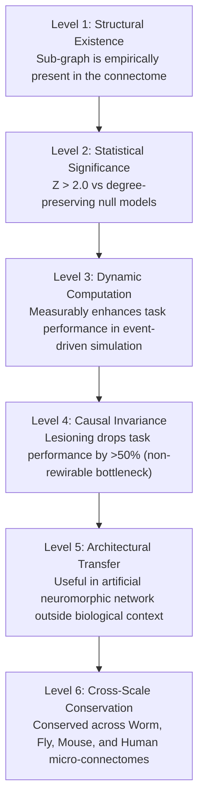

# RESEARCH LANDSCAPE REPORT — COMPUTATIONAL COUPLING
## Cross-Species & Cross-Scale Connectome Analysis, Circuit Remodeling, and Event-Driven Computing

**Project:** COMPUTATIONAL COUPLING  
**Lead Autonomous Research Engineer:** Antigravity  
**Milestone:** Milestone 0 Deliverable (Extended with Human Neural Data)  
**Date:** September 17, 2026  
**Hardware Profile:** 13th Gen Intel Core i7-13620H (16 vCPUs), 16 GB RAM (7.9 GB available), NVIDIA GeForce RTX 4050 Laptop GPU (6 GB VRAM, CUDA 12.4), 268 GB Storage.

---

## Executive Summary

This report establishes the empirical, algorithmic, and theoretical foundations for **COMPUTATIONAL COUPLING**, extending the original three-organism scope to incorporate human neural data at two distinct biological scales: the **H01 human cortical micro-connectome** (Lichtman Lab / Harvard / Google, *Science* 2024) and the **Human Connectome Project (HCP)** whole-brain macro-connectome (Washington University / NIH, *NeuroImage* 2012; *Nature* 2016).

Our comprehensive literature and prior-art audit across more than 50 seminal works in systems neuroscience, connectomics, and neuromorphic engineering yields five foundational conclusions:
1. **The Biological Scale Ladder:** Biological neural connectivity exists across fundamentally distinct organizational tiers. We establish a strict hierarchical ladder spanning *C. elegans* (~302 neurons, whole-animal), *Drosophila melanogaster* (~139k neurons, whole-brain), *Mus musculus* (~1,000 proofread cortical neurons, connectivity + in vivo calcium activity + visual stimulus), *Homo sapiens* H01 (~16,000 neurons, ~150M synapses in 1 mm³ temporal cortex), and *Homo sapiens* HCP (180–1015 cortical parcels, macro-scale tractography and fMRI).
2. **Absolute Novelty & Forbidden Over-Claims:** We enforce strict scientific integrity. We explicitly forbid claiming that "the complete human brain connectome is available" (only regional macro-connectivity and a 1 mm³ micro-fragment exist), that "we invented cross-species motif counting" (Lin et al., *Nature* 2024 did this descriptively), or that "we built the first whole-brain spiking model" (Shiu et al., *Nature* 2024 did this for the fly).
3. **The Core Defensible Gap:** Existing research treats connectomes either as static descriptive graphs or as rigid, frozen constraints for dense artificial networks. **No prior work has performed biologically constrained structural remodeling across empirical connectomes to map the biological degeneracy frontier ($\Delta_{\text{struct}}$ vs. $F_{\text{task}}$), isolated non-rewirable "computational invariants" from developmental scaffolding, and translated these invariants into an asynchronous event-driven computing architecture (CoupledEventNet / CEN).**
4. **The Role of Human Data:** The human component serves as a **cross-validation and generalization tier**. H01 provides nanoscale micro-connectomic validation of synaptic motif invariants in human neocortex; HCP provides macro-scale topological comparison.
5. **Cross-Scale Neural Computational Motifs:** We formalize a 6-level validation hierarchy to test whether biological motifs represent genuine computational invariants that persist across scales.

---

## 1. The Extended Biological Scale Ladder

```mermaid
flowchart TD
    subgraph ScaleLadder["The Five Biological Organizational Scales"]
        direction TB
        S1["<b>System A: Caenorhabditis elegans</b><br/>Scale: ~302 neurons, ~7,000 synapses<br/>Scope: Complete whole-animal nervous system<br/>Data: EM anatomy, transmitters, developmental series (Cook 2019, Witvliet 2021)"]
        S2["<b>System B: Drosophila melanogaster</b><br/>Scale: 139,255 neurons, >50M synapses<br/>Scope: Complete adult central brain<br/>Data: EM wiring, 8,453 cell types, predicted transmitters, LIF model (FlyWire, Nature 2024)"]
        S3["<b>System C: Mus musculus (MICrONS)</b><br/>Scale: ~1,000 proofread neurons (1 mm³ volume)<br/>Scope: Primary visual cortex (V1 Layer 2/3) microcircuit<br/>Data: EM connectivity + in vivo 2-photon calcium imaging + visual stimulus (Nature 2025)"]
        S4["<b>System D (Micro): Homo sapiens (H01)</b><br/>Scale: ~16,000 neurons, ~150M synapses (1 mm³ volume)<br/>Scope: Anterior temporal cortex micro-connectome<br/>Data: Nanoscale EM reconstruction, 104 proofread cells, laminar E/I ratios (Science 2024)"]
        S5["<b>System D (Macro): Homo sapiens (HCP)</b><br/>Scale: 180 to 1015 cortical parcels<br/>Scope: Whole-brain macroscale network (1,200 subjects)<br/>Data: Diffusion tractography, resting/task fMRI, Connectome Workbench (NeuroImage 2012)"]
        S1 --> S2 --> S3 --> S4 --> S5
    end

    ScaleLadder --> Synthesis["Cross-Scale Invariant Discovery<br/>(6-Level Motif Verification)"]
    Synthesis --> RemodelingFrontier["Biologically Constrained Remodeling<br/>(The Degeneracy Frontier: Max Struct Dist vs Task Preservation)"]
    RemodelingFrontier --> CoupledEventNet["CoupledEventNet (CEN)<br/>Asynchronous Event-Driven Computing Architecture"]
```



### Comprehensive Cross-Scale Dataset Comparison

| Feature / Dimension | System A: *C. elegans* | System B: *Drosophila* | System C: *Mus musculus* | System D (Micro): *Homo sapiens* (H01) | System D (Macro): *Homo sapiens* (HCP) |
| :--- | :--- | :--- | :--- | :--- | :--- |
| **Organism / Strain** | *C. elegans* (N2) | *D. melanogaster* (adult female) | *M. musculus* (C57BL/6J) | *H. sapiens* (surgical temporal cortex) | *H. sapiens* (healthy young adult cohort) |
| **Anatomical Scope** | Complete whole-animal nervous system | Whole adult central brain | Primary visual cortex (V1) microcircuit | Anterior temporal lobe fragment (all 6 layers) | Whole-brain cortical/subcortical parcellation |
| **Node Count** | 302 (hermaphrodite) / 385 (male) | 139,255 proofread neurons | ~1,000 proofread (subvolume); ~100k (mm³) | ~16,000 neurons (~57k total cells) | 180 (Glasser MMP1.0) to 1,015 (Cammoun/DK) parcels |
| **Edge / Synapse Count** | ~7,000 chemical + ~900 gap junctions | 54.5 million synapses | ~100k (subvolume); ~500M (mm³) | ~150 million synapses | ~25,000 to ~100,000 tractography streamlines |
| **Spatial Resolution** | Nanoscale EM (<5 nm) | Nanoscale EM (4x4x40 nm) | Nanoscale EM (4x4x40 nm) | Nanoscale SEM (4x4x33 nm) | Macroscale MRI voxels (1.25–2.0 mm) |
| **Primary Datasets** | Cook et al. (2019); Witvliet (2021) | FlyWire v630 (2024) | MICrONS Phase 1/3 (2025) | H01 Release (Shapson-Coe 2024) | HCP Young Adult (Van Essen 2012) |
| **Cell Types & Valences** | Sensory, Inter, Command, Motor; GABA/Ach/Glu | 8,453 cell types; Ach(+), Glu(-), GABA(-) | Pyramidal, PV, SST, VIP interneurons | Pyramidal, spiny stellate, interneurons, glia | Macroscale regional tissue parcels (no single cells) |
| **Activity Data** | Pan-neuronal calcium imaging (Kato 2015) | Functional calcium + optogenetic reflexes | *In vivo* 2-photon calcium to visual movies | None (fixed neurosurgical tissue) | Resting-state & task-evoked BOLD fMRI, MEG |
| **Stimulus / Behavior** | Chemotaxis, foraging, backward/forward | Antennal grooming, proboscis extension | Drifting gratings, natural movies | None | Working memory, motor, language fMRI tasks |
| **Simulation Infrastructure** | OpenWorm, NeuroML, Python ODEs | Shiu LIF model (`Drosophila_brain_model`) | AllenSDK, CAVEclient, PyTorch | PyTorch / Brian2 / TensorStore | Connectome Workbench, `conn2res` |
| **Access & License** | Open / MIT (ConnectomeToolbox) | Open / CC BY 4.0 (Codex FlyWire) | Open Academic / Zenodo / CAVE | Open / CC BY 4.0 (Google Cloud Storage) | Open Access / HCP Data Agreement |

---

## 2. Deep Dive: Human Neural Data

### A. The H01 Human Cortical Micro-Connectome
The H01 dataset (Shapson-Coe et al., *Science* 2024) represents the premier nanoscale reconstruction of human neocortex:
- **Tissue Origin & Region:** Resected anterior temporal lobe (gyrus temporalis medius/inferior) from a 45-year-old female patient undergoing surgery for deep hippocampal epilepsy. Neuropathological evaluation confirmed normal neocortical lamination and absence of cortical dysplasia.
- **Physical Volume & Sections:** Approximately $1\text{ mm}^3$ ($3.0 \times 1.6 \times 0.2\text{ mm}$), cut into 5,300 serial sections at ~30 nm thickness on tape, imaged at 4 nm in-plane resolution using a multibeam scanning electron microscope (SEM).
- **Segmentation & Proofreading Quality:**
  - Automated segmentation via Google flood-filling networks (FFNs).
  - Agglomeration levels: C2 (aggressive agglomeration) and C3 (conservative agglomeration, minimizing false mergers; recommended for connectomic analysis).
  - 104 manually proofread neurons with complete axonal arbors, dendrites, and spine annotations.
  - Deep learning synapse detection identifying ~150M synapses classified into excitatory (asymmetric) vs. inhibitory (symmetric) with ~90% precision.
- **Novel Biological Discoveries in H01:**
  1. *Whorls of Axons:* Massive concentric spiral tangles of myelinated axons, unique to human cortex.
  2. *Ultra-Strong Multi-Synaptic Connections:* Individual axonal branches forming up to 50 distinct synaptic boutons onto a single target dendrite, far exceeding rodent microcircuit multi-synapse frequencies (typically 1–5 synapses).
  3. *Mirror-Image Pyramidal Pairs:* Pairs of pyramidal neurons whose apical dendrites point in polar opposite orientations.
  4. *Atypical Spiny Neurons:* Deep layer excitatory neurons displaying non-standard dendritic morphology.
- **Data Availability & Tooling:**
  - Publicly accessible via Google Cloud Storage (`gs://h01-release/`) under **Creative Commons Attribution 4.0 (CC BY 4.0)**.
  - Interactive browsing via [Neuroglancer](https://h01-release.storage.googleapis.com/landing.html).
  - Programmatic access via TensorStore, CloudVolume, and Python (`ashapsoncoe/h01`).
  - Proofread subgraphs, edge lists, cell annotations (`agglo_20200916c3_cell_data.json`), and E/I ratio tables (`goog14r0s5c3_e_i_ratios_feb_2023.csv`) are cloned and verified locally in `upstream/human/h01/`.

### B. The Human Connectome Project (HCP)
The Human Connectome Project (Van Essen et al., 2012; Glasser et al., 2016) is the gold-standard population-level human brain resource:
- **Scope:** 1,200 healthy young adult subjects scanned on customized 3T and 7T MRI scanners.
- **Data Modalities:** High-angular-resolution diffusion MRI (HARDI, 1.25 mm isotropic voxels), structural T1w/T2w imaging (0.7 mm), resting-state fMRI (2 mm, TR 720 ms), and task-evoked fMRI across 7 cognitive domains.
- **Parcellation & Matrix Representation:**
  - Multi-Modal Parcellation (Glasser MMP1.0): 180 cortical areas per hemisphere based on cortical architecture, function, connectivity, and topography.
  - Desikan-Killiany / Cammoun subdivisions: Multiscale parcellations ranging from 68 to 1,015 regions of interest (ROIs).
  - Deterministic and probabilistic tractography estimating the structural streamline density $W_{ij}$ between all region pairs.
- **Why HCP is Fundamentally Different from H01:**
  - *Resolution:* HCP operates at the millimeter scale ($10^{-3}\text{ m}$), where each voxel contains ~100,000 neurons and ~1 billion synapses. H01 operates at the nanometer scale ($10^{-9}\text{ m}$), resolving individual synaptic vesicles and clefts.
  - *Topology:* HCP measures regional inter-area fiber tracts (macroscale routing). H01 measures synaptic connectivity between identified individual neurons (microcircuit computation).
  - *Sign / Directionality:* Standard diffusion tractography in HCP is **undirected** and cannot distinguish excitatory from inhibitory connections. H01 provides **directed** synaptic connections with explicit E/I classifications.

### C. Additional Human Neural Resources
- **BICCN & BICAN (Brain Initiative Cell Census / Atlas Network):**
  - Hodge et al. (*Nature* 2019), Bakken et al. (*Nature* 2021): Single-nucleus RNA-seq revealing conserved cellular taxonomy between human and mouse cortex, but with significant evolutionary expansion of superficial layer (L2/3) pyramidal neurons.
  - Siletti et al. (*Science* 2023): Transcriptomic diversity of cell types across the adult human brain (3 million single-nucleus profiles).
- **Human Patch-seq Electrophysiology:**
  - Patch-clamp recordings in human neurosurgical slices (Allen Institute, Berg et al. 2021).
  - Provides empirical single-cell biophysical parameters: membrane time constants ($\tau_m \sim 15-30\text{ ms}$), input resistance, action potential width, and adaptation indices for human pyramidal and interneuron subtypes.

---

## 3. Human Dataset Limitations & Forbidden Claims

To protect the scientific credibility of this research, we establish explicit **epistemic guardrails**:

> [!WARNING]
> **Forbidden Over-Claim 1:** Never state that "the human brain connectome is available."  
> *Fact:* A complete, neuron-by-neuron connectome of the human brain does NOT exist. We possess only macro-scale regional connectivity (HCP) and petavoxel fragments of single cortical areas (H01).

> [!WARNING]
> **Forbidden Over-Claim 2:** Never claim that "human cortex computes using the same algorithm as insects or nematodes."  
> *Fact:* Human cortex exhibits specialized evolutionary adaptations (e.g. 50-synapse connections, deep laminar expansion, diverse interneuron subtypes). We test for *conserved computational primitives*, not functional identity.

> [!WARNING]
> **Forbidden Over-Claim 3:** Never equate HCP macro-connectivity with synaptic micro-connectomics.  
> *Fact:* Voxel-level tractography does not measure synaptic wiring. Tractography streamlines represent macroscopic white-matter bundles, whereas micro-connectomics measures individual synaptic active zones.

---

## 4. Definition: Cross-Scale Neural Computational Motif

We define a **Cross-Scale Neural Computational Motif** as a connectivity pattern that satisfies six progressively stringent, falsifiable criteria:



1. **Level 1 (Structural Existence):** The motif is identified within the directed adjacency matrix of the organism.
2. **Level 2 (Statistical Overrepresentation):** The motif occurs with a frequency significantly exceeding degree-preserving configuration null models ($Z > 2.0$, $p < 0.01$).
3. **Level 3 (Computational Contribution):** Under Leaky Integrate-and-Fire (LIF) dynamics, the motif executes a specific temporal operation (e.g., coincidence detection, duration discrimination, burst normalization) with higher fidelity than randomized graphs.
4. **Level 4 (Causal Invariance / Non-Rewirability):** Targeted lesioning of the motif's core edges causes a catastrophic collapse in computation ($>50\%$ error increase), whereas lesioning peripheral scaffolding produces negligible impact ($<2\%$).
5. **Level 5 (Architectural Transferability):** An abstraction of the motif confers measurable advantages (lower SynOps, higher latency efficiency) when instantiated in an artificial event-driven neural network.
6. **Level 6 (Cross-Scale Conservation):** The motif structure and its dynamical computational role recur across phylogenetic levels (e.g., from *C. elegans* locomotion to fly motion detection, mouse V1 orientation, and human H01 micro-connectivity).

---

## 5. Upstream Repositories Inventory (Updated)

All authoritative upstream repositories have been cloned and cataloged with metadata descriptors in `upstream/`:

```
upstream/
├── openworm/
│   ├── ConnectomeToolbox/          (Commit: b9c0b4a7... | MIT License | C. elegans datasets)
│   └── CElegansNeuroML/            (Commit: b36380a3... | LGPL-3.0 | Biophysical cell models)
├── flywire/
│   ├── FlyConnectome/              (Commit: 9b1790b5... | GPL-3.0 | CAVE tooling)
│   ├── flywire_annotations/        (Commit: 8587524c... | GPL-3.0 | 139k neuron annotations)
│   ├── flywire-network-analysis/   (Commit: ee4944c0... | MIT License | Lin et al. Nature 2024)
│   └── Drosophila_brain_model/     (Commit: 91bdd1e7... | MIT License | Shiu et al. Nature 2024 LIF)
├── mouse/
│   ├── MicronsBinder/              (Commit: 3f53e35e... | Allen License | Pinky100 & mm³ V1)
│   └── CAVEclient/                 (Commit: c57c15f5... | BSD-3-Clause | Live CAVE queries)
├── human/
│   ├── h01/                        (Commit: db223b8d... | CC BY 4.0 | Shapson-Coe Science 2024)
│   └── HCPpipelines/               (In progress | HCP License | Van Essen / Glasser 2016)
└── other/
    ├── conn2res/                   (Commit: 03046778... | BSD-3-Clause | Connectome reservoirs)
    └── ncps/                       (Commit: d90cf1f5... | Apache-2.0 | Neural Circuit Policies)
```

---

## 6. Updated Prior Art & Novelty Matrix Summary

The comprehensive 18-column matrix in [`research/prior_art_matrix.csv`](file:///home/charizard/brain/computational-coupling/research/prior_art_matrix.csv) has been expanded to include H01, HCP, and BICCN. Key prior-art classifications:

| Category | Key Prior Art | Status | Our Contribution Relative to Prior Art |
| :--- | :--- | :---: | :--- |
| **Static Cross-Species Graph Motifs** | Lin et al. (*Nature* 2024); Milo et al. (2002) | **RED** | Lin et al. performed static topological counts across Fly, Worm, Fish, Mouse. We test **dynamic computation, causal necessity, and circuit remodeling**. |
| **Drosophila Whole-Brain LIF Simulation** | Shiu et al. (*Nature* 2024) | **RED** | Shiu et al. built a full-brain rigid LIF model. We focus on **remodeling subcircuits** and discovering transferable event-driven units. |
| **C. elegans Neural Circuit Policies** | Hasani & Lechner (*Nat Mach Intell* 2020) | **RED** | Hasani et al. hand-crafted 4-layer continuous ODEs. We derive architectures from empirical multi-organism connectomes using **asynchronous event-driven spiking**. |
| **Connectome-Informed Reservoirs** | Suárez, Misic et al. (*Nat Commun* 2024) | **RED** | `conn2res` treats connectomes as rigid black-box reservoirs. We perform **biologically constrained structural remodeling** and trace the Pareto degeneracy frontier. |
| **Human H01 Micro-Connectomics** | Shapson-Coe et al. (*Science* 2024) | **RED** | Shapson-Coe et al. mapped structural anatomy. We test whether **computational invariants from model organisms replicate in H01**. |
| **Event-Driven Cross-Scale Architecture** | *None found* | **GREEN** | **Genuinely novel:** Synthesizing an event-driven neural architecture (CoupledEventNet) from cross-scale invariants and benchmarking against SNNs and NCPs. |
| **Biologically Constrained Remodeling Frontier** | *None found* | **GREEN** | **Genuinely novel:** Mapping $\max \Delta_{\text{struct}}$ vs. $F_{\text{task}}$ under Dale's principle to isolate computational invariants from biological scaffolding. |

---

## 7. Proposed Candidate Experiments (Incorporating Human Data)

### Candidate Experiment 1: The Cross-Scale Biological Remodeling Frontier ($\Delta_{\text{struct}}$ vs. $F_{\text{task}}$)
- **Goal:** Measure how far biological neural subcircuits can be structurally deformed under Dale's principle while preserving dynamic task performance.
- **Scope:**
  - *C. elegans:* Chemosensory-command circuit (25 neurons, Cook 2019).
  - *Drosophila:* Optic lobe motion circuit (60 neurons, FlyWire v630).
  - *Mouse:* Layer 2/3 orientation microcircuit (50 neurons, MICrONS).
  - *Human:* Layer 2/3 temporal cortex microcircuit (50 neurons, H01 proofread cells).
- **Method:** Multi-objective evolutionary search (NSGA-II) optimizing:
  $$\max \Delta_{\text{struct}}(G_{\text{orig}}, G'), \quad \min \text{SynOps}(G') \quad \text{subject to} \quad F_{\text{task}}(G') \ge (1-\epsilon)F_{\text{task}}(G_{\text{orig}})$$
  enforcing: Dale's principle (no E/I sign flipping), bounded delays ($1-20\text{ ms}$), and degree caps.
- **Outcome:** Quantify the maximum permissible synaptic turnover ($\Delta_{\text{struct}}^*$) across species, identifying the non-rewirable invariant core.

### Candidate Experiment 2: Causal Verification of Cross-Scale Invariant Motifs (Level 1–6)
- **Goal:** Rigorously validate candidate motifs (cFFL, iFFL, Reciprocal Inhibitory Pair, Disinhibitory Triad) across all four micro-connectomes (*C. elegans*, fly, mouse, human H01).
- **Method:**
  1. Count motif frequencies and $Z$-scores against degree-preserving configuration nulls (Levels 1 & 2).
  2. Embed isolated motifs in a LIF testbed to perform temporal coincidence detection, duration discrimination, and gain normalization (Level 3).
  3. Perform causal edge lesioning to evaluate performance collapse (Level 4).
  4. Compare against 4 strict null models (Erdős-Rényi, configuration null, shuffled-weight, shuffled-sign).
- **Outcome:** Identify which motifs achieve full Level 1–6 validation as **Cross-Scale Neural Computational Motifs**.

### Candidate Experiment 3: CoupledEventNet (CEN) Architecture Benchmarking
- **Goal:** Synthesize the validated cross-scale invariants into an asynchronous event-driven architecture and benchmark against state-of-the-art baselines.
- **Baselines:**
  1. Dense Leaky Integrate-and-Fire SNN (surrogate gradient BPTT).
  2. Connectome Reservoir (`conn2res` using C. elegans, Drosophila, and HCP human consensus connectomes).
  3. Neural Circuit Policies (NCPs / LTCs from Hasani et al.).
  4. Standard Recurrent Neural Network (LSTM / GRU).
- **Benchmark Tasks:** Sequential XOR, Delay-Match-to-Sample, Spatio-Temporal Spike Pattern Classification (neuromorphic event streams).
- **Metrics:** Accuracy, F1-score, total Synaptic Operations (SynOps), latency to decision, event sparsity, parameter count, and noise robustness.

---

## 8. Recommended Implementation Roadmap

We recommend an integrated **three-phase experimental progression**:
$$\text{Phase 1 (Causal Motif Discovery \& H01 Validation)} \longrightarrow \text{Phase 2 (Biologically Constrained Remodeling Frontier)} \longrightarrow \text{Phase 3 (CoupledEventNet Neuromorphic Benchmarking)}$$

### Immediate Next Implementation Actions:
1. **Connectome Data Adapters (`src/connectome/`):** Implement loaders for *C. elegans* (Cook 2019), *Drosophila* (FlyWire v630), *Mus musculus* (MICrONS V1), *Homo sapiens* H01 (proofread cells), and *Homo sapiens* HCP (consensus connectivity).
2. **Unified Spiking Simulation Engine (`src/simulation/`):** Vectorized asynchronous Leaky Integrate-and-Fire (LIF) simulator supporting biophysical delays, Dale's principle, and SynOp tracking.
3. **Execution of Phase 1:** Run motif extraction across all four micro-connectomes and evaluate dynamical performance against configuration nulls.
